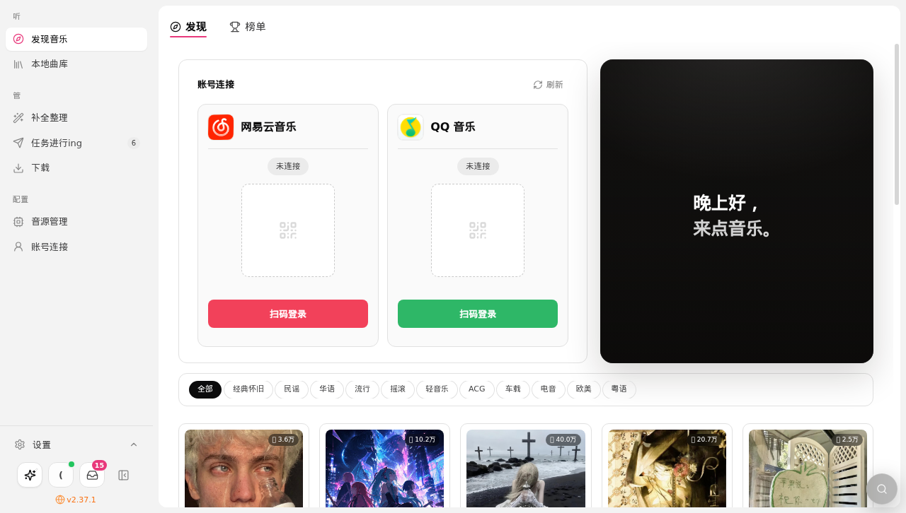
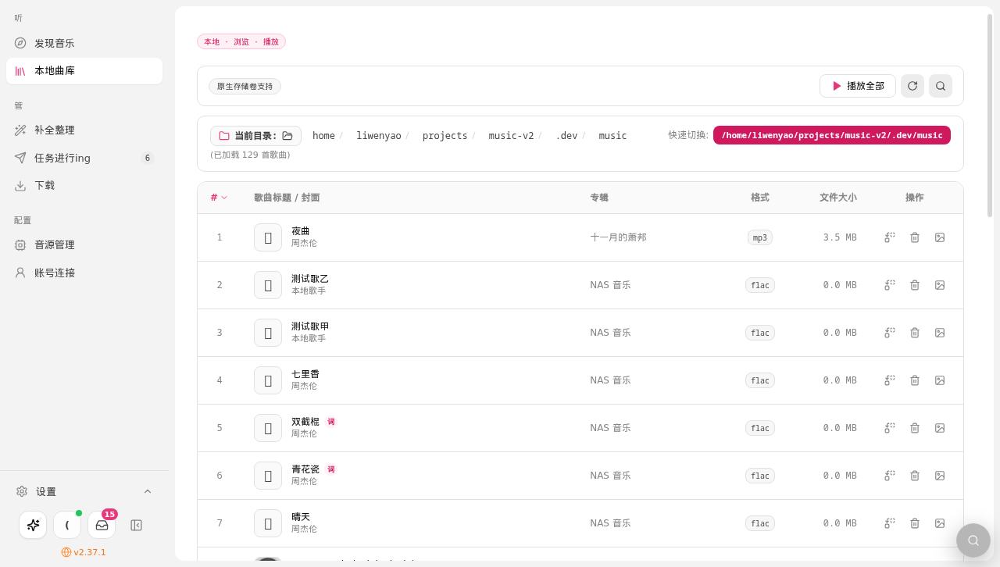
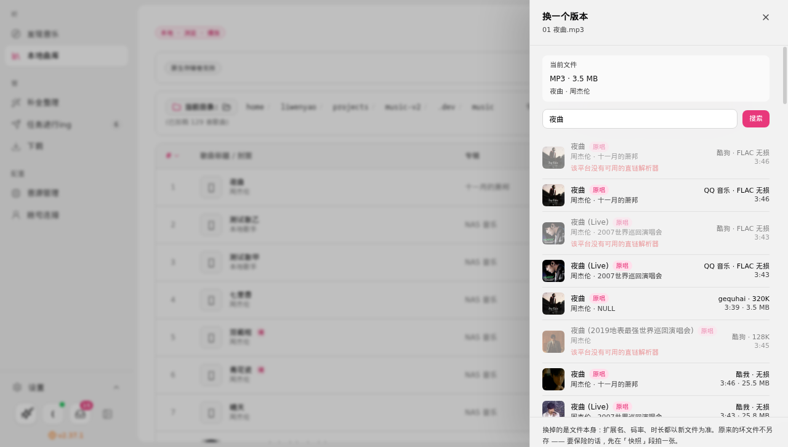
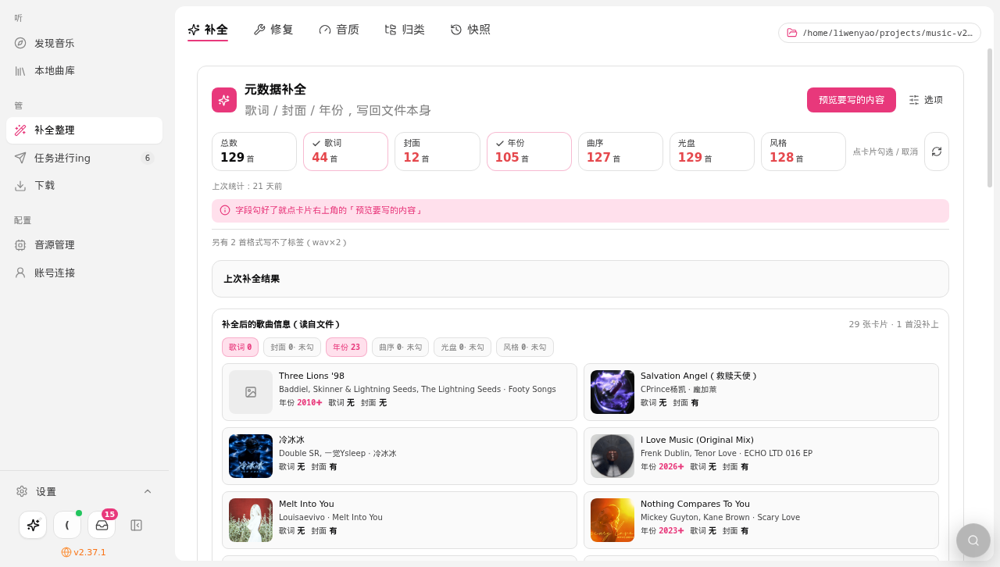
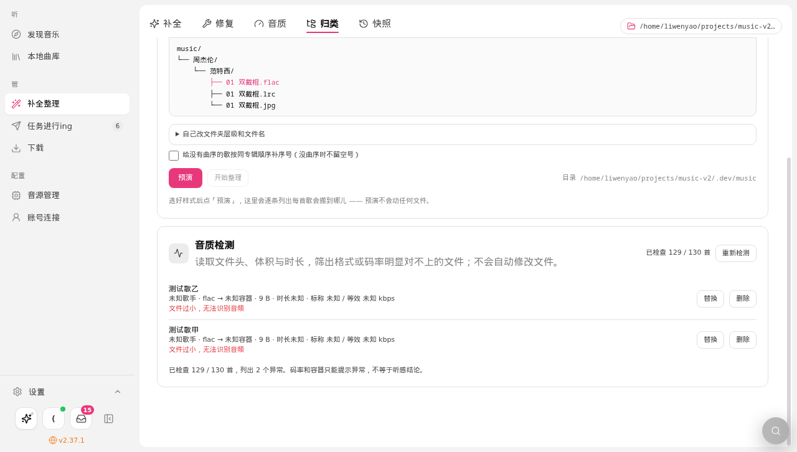
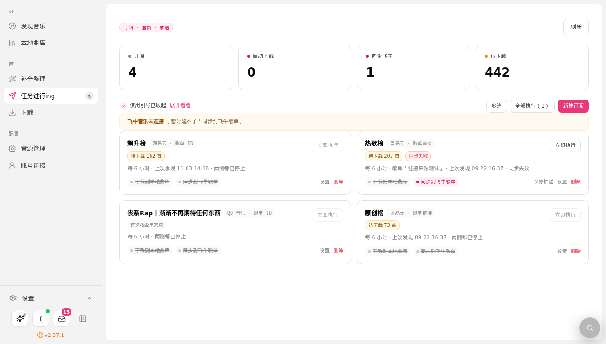
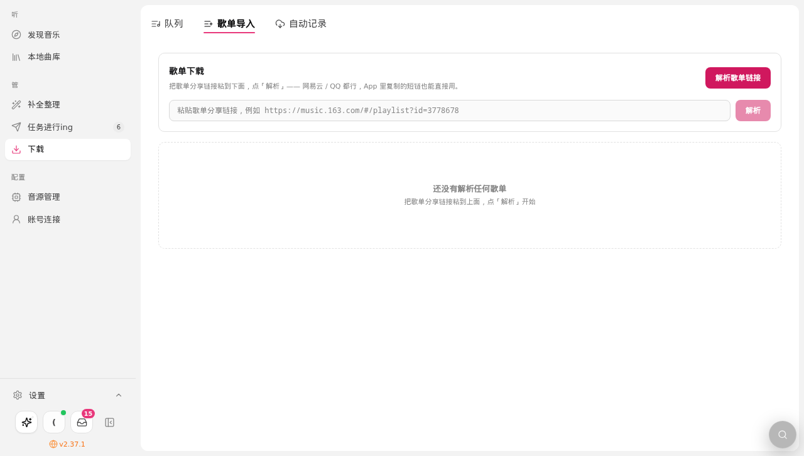
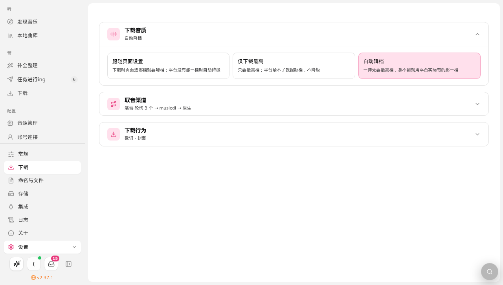

<div align="center">

# 🎵 曲率 · yinshu-ai

**飞牛私有云 OS (fnOS) 上的 AI 音乐中枢**
在线播放 · 订阅追更 · 无损下载 · 曲库整理 · 官方 App 深度接管

[](https://developer.fnnas.com/)
[](https://vuejs.org/)
[](https://go.dev/)
[](RELEASE_NOTES.md)
[](LICENSE)

个人项目 · 作者 [@liwenyao016828](https://github.com/liwenyao016828) · 代码由作者主导、AI 协作完成

[📦 下载最新版](https://github.com/liwenyao016828/fnmusic/releases/latest) · [✨ 功能](#-功能) · [📥 安装](#-安装) · [🙏 致谢](#-致谢) · [🧭 架构](#-架构一页话) · [🛠️ 开发](#️-开发) · [🔌 开放接口](#-开放接口供-ai-与外部程序调用)

</div>

---


<div align="center"><sub>沉浸播放器：黑胶唱机大屏、双语歌词点词跳播、封面取色做氛围背景</sub></div>

---

> **v2.0.0 起更名**：原「极光音乐」(`fn-lx-player`) → **曲率** (`yinshu-ai`)。
> `appname` 不同，飞牛会把它当成**另一个应用**，**不覆盖**旧版，两者可并存（新 8898 / 旧 8899）。
> 数据目录独立，历史数据不会自动迁移。
>
> 本 README 里的数字都可由 [开发](#️-开发) 一节的命令复现；逐版变更见
> [`RELEASE_NOTES.md`](RELEASE_NOTES.md)，架构与踩坑见 [`HANDOVER.md`](HANDOVER.md)。
> 截图来自开发实例（演示曲库），实际界面随版本微调。

## ✨ 功能

导航是三层：**听**（发现音乐 / 本地曲库）· **管**（补全整理 / 订阅更新 / 下载）· **配置**（音源管理 / 账号连接 / 设置）。

### 🔍 发现音乐



- **全网聚合搜索**：多平台搜索去噪（`GET /api/search`），按音源启用池挑源取链；
  聚合有等待上限，慢平台不会拖住整个搜索结果。
- **榜单 / 精选歌单**：官方协议直连（后端内置，免脚本）浏览网易云与 QQ 音乐的榜单与分类歌单；
  点开即看曲目、直接播、可「订阅更新」。
- **榜单注入**：勾选的榜单以**只读在线歌单**出现在飞牛音乐 App 里，卡片右上角「+ 注入」就地切换。
- **双平台推荐**：已登录账号的每日推荐与账号歌单；可选的大模型推荐层（会发收听历史给模型，独立开关）。
- **正在播放卡**：发现页右侧一张深色卡，直接接管播放控制，不用等播放条。
- **手机端**：账号连接卡一行两张，只显示「已连接 / 未连接」——手机扫自己屏幕上的码没意义，
  点未连接标签会提示去电脑上扫码。

### 📁 本地曲库 + 换版本



深扫各存储卷（FLAC / APE / WAV / DSD / MP3 / AAC / OGG），HTTP 206 分片串流、
内嵌封面与标签解析、歌词自动关联；目录树随选随切。

- **点歌名/封面即播**：整行标题区是播放入口，封面悬停会浮出播放三角；操作按钮各自拦住冒泡，不会误触播放。
- **换版本**：每首歌右边一颗按钮，按歌名去各平台找同名版本，挑一条直接**覆盖原文件**。



候选列表有三件事值得说：

| 能力 | 说明 |
|---|---|
| **先验可用再让你点** | 打开就批量预检每条候选能不能取到直链（不下载、不写盘），取不到的直接置灰并写明原因；「这次没拿到」和「稳定拿不到」分得开，后者才置灰 |
| **原唱 / 翻唱** | 按歌名、歌手与本地文件比对，用胶囊标签标出来，原唱排前面；跟随主题色，不写死颜色 |
| **按匹配度排** | 歌名完全一致 > 开头一致 > 包含 > 只沾边，长度差越小越靠前；同分再看档位、时长接近度 |

搜索框只填**歌名**（自动去掉曲序前缀、`- ls` 之类的后缀、括号补充），比「歌名 + 歌手」命中率高得多。

### 🧹 补全整理

五个分段常驻页头：补全 / 修复 / 音质 / 归类 / 快照。



- **补全**：顶部一排卡片直接告诉你「总数 / 歌词缺几首 / 封面缺几首 / 年份 / 曲序 / 光盘 / 风格」，
  **点卡片就是勾选要补的字段**（不用再去下面那排标签里挑）→ 预览 → 确认写入 → 可撤销。
  补全的值**一律来自已匹配的搜索结果，不让 AI 猜**。
- **修复**：歌名不对 / 内容重复 / 文件名非法 / 音频不对（格式不符 · 时长过短 · 假无损）四类合成一张清单，
  条数按类分。另有**版本时长核对**：拿本地实测时长去比同名平台版本，标出「可能不是这个版本」——
  这些异常常伴随错误的文件，先看再决定换不换。
- **音质**：扫曲库（默认只扫有损）→ 逐首列出**各渠道实际能拿到什么档位** → 勾选后用最高音质原地替换。
  档位按**实际字节率**判（mp3 读第一帧标称码率，洛雪按实测字节数 ÷ 时长推算），信不过脚本自报的「无损」。
  每次替换落一条**可查记录**（文件 / 歌名 / `from → to` / 渠道 / 成败），进页就能看见。
- **归类**：按「歌手 / 专辑 / 曲目」把歌搬进文件夹，同一首的音频 / 图片 / 歌词同名同目录；搬完可撤销。
  这一段里还有**音质检测**——读文件头、体积与时长，筛出格式或码率明显对不上的文件，逐条给「替换 / 删除」。



- **快照**：每次补全 / 修复前的快照，可逐条撤回；另有定时与手动快照。删除一律进 `.tidy_trash` 回收站，不直删。

### 🔔 订阅更新



歌单 / 榜单 / 账号歌单监控，每轮自动发现新歌；**首轮只建基线不下载**；
支持干跑预览、版本过滤（Live / Remix / 伴奏剔除）、缺口补下载、飞牛同步历史。
卡片上直接标「待下载 N 首 / 同步失败」，点开就是明细。

### ⬇️ 下载



- **取音渠道可配**：洛雪 → musicdl → 原生，顺序与开关都能调。
  **洛雪多选 = 轮询**：按你在音源页排的顺序挨个问，取**实际档位最高**的那条（不是第一个能下的就赢）。
- **歌单导入**：粘贴歌单分享链接（网易云 / QQ / App 里复制的短链都行），整单解析后批量下载。
- **收藏自动下载**：飞牛里收藏 / 加歌单即后台整轨下载并绑定本地。
- **音质补强**：这次拿不到无损就先落一份能拿到的，之后后台每 20 分钟一轮、失败冷却 24 小时、累计 5 回收手 ——
  不再「只试一次就永久放弃」，也不会「每次收藏白下一遍」。
- **查询失败原因给到渠道级**：哪条链没取到、是脚本报错还是平台没有同名版本，都在任务里写清楚。
- **下载统一由后端执行**：前端选歌并提交任务，通过接口查看状态、暂停 / 继续 / 重试。任务由服务端持久化，关闭网页后继续执行；服务重启后恢复未完成的队列。能否取得音频取决于已配置且可用的服务端音源。

### 🎛️ 音源管理

- **两种互补协议**：`official`（后端内置，免脚本，搜索 / 榜单 / 歌单 / 歌词）+ `lx`（脚本，取直链）。
  没导入任何脚本时，搜索 / 榜单 / 歌单 / 歌词照常用，只有播放与下载需要一份 LX 脚本。
- 脚本 URL 订阅 / 本地上传 / 批量导入，自动去重；**多选启用池**（有序优先）。
- 服务型音源：按服务地址接入。下载使用服务端可访问的渠道；仅能在浏览器中运行的脚本，需要配置相应服务端宿主后才能用于后台下载。
- 熔断与健康度（连续失败 60 秒冷却）、真实探针测速、平台健康度统计。

### 👤 账号连接

网易云 / QQ 音乐扫码登录；AI 大模型（OpenAI 兼容）配置也在这页。
账号数据用于每日推荐、账号歌单推送、在线收藏与歌单接管。

### 🎧 沉浸播放器

黑胶唱机大屏：氛围背景取封面主色、双语歌词对照、点词跳播、顺序 / 随机 / 单曲循环。
手机端左右滑动切页（跟手位移 + 阻尼弹簧），底部一颗搜索图标点开才滑出搜索框。

### 🖥️ 设置与日志



设置入口在**侧栏左下角**，点开是一列分类（常规 / 下载 / 命名与文件 / 存储 / 集成 / 日志 / 关于），
选中一类只显示这一类的设置项；点其它页面会自动收起，点框里的分类不会。
「发现新版本」与任务状态收成图标，和 AI 助手、音源图标排在同一行，右上角带小角标，点开是明细。
日志是环形缓冲（重启即清），也在这个入口里。

## 🔌 开放接口（供 AI 与外部程序调用）

本应用的设计目标之一就是**让别的 AI / 程序能直接调**：

- 后端 **202 个** HTTP 接口，全部标准 JSON（`{code,message,data}`），16 个分类。
- **接口自描述**：`GET /api/catalog` 返回全部接口 + 工作流指南 + 坑位提醒；
  前端点左上角软件图标滑出「开放接口」抽屉，渲染的是同一份数据。
- **下载任务接口**：提交后由后端取链、下载和保存结果，客户端通过查询与控制接口管理队列，无需保持网页连接。
- 长任务一律「立即返回 + 轮询」；写文件的动作都有干跑 / 预览 / 回收站 / 备份。

```bash
curl http://NAS:8898/api/app/version
curl http://NAS:8898/api/catalog                 # 全部接口 + 用法
curl -X POST http://NAS:8898/api/search -H 'Content-Type: application/json' -d '{"keyword":"晴天"}'
```

> 数数口径：`grep -cE "Method: +(http\.)?Method[A-Z]" backend/pkg/api/catalog.go` = 202；
> internal 名单 51 条（其余 151 条为 core）；`cd backend && go list ./... | wc -l` = 45 包。

## 🧭 架构一页话

**Go 后端**（`backend/`）以静态二进制运行在飞牛原生 FPK 应用中。负责 HTTP API、
鉴权、搜索 / 榜单 / 歌词聚合、下载任务持久化与执行、曲库索引与标签读写、订阅调度和飞牛集成。
下载只有一套服务端执行队列：后端取音、检查本地文件、下载并保存结果，不依赖浏览器继续派发任务。
前端构建产物通过 `go:embed` 嵌入二进制；可选音源宿主作为独立进程运行。

**Vue 3 前端**（`frontend/`，Vite + Tailwind）负责选歌、配置、提交下载、展示队列和发送控制命令。
前端不再维护另一套下载执行器；关闭页面不会中断已由服务端接受的任务。
业务纯函数用 `node --test` 验证。
界面是「安静玻璃」风格：中性色打底，品牌青玉只留给**正在发生的事**，控件 10px / 卡片 18px 圆角，
动效三档（160 / 260 / 360ms，`cubic-bezier(.32,.72,0,1)`），尊重「减弱动效」。

**Python sidecar**（`sidecar/musicdl_service/`）可选外挂音源：把 musicdl 的注册源接进搜索与解析，
补齐咪咕等 Go 侧没有的平台。缺省关，打开后自建 venv（约一两百 MB）。

**洛雪宿主**（`sidecar/lx_host/server.mjs`，Node）⚠️ **它会执行第三方 JS**：
把用户导入的 LX 脚本放在独立 Node 进程中执行，为后端提供取直链能力。
该能力默认关闭（`lx_server_enabled`），需要显式开启并配置可信脚本；Node 的 `vm` 并非完整安全隔离边界。
宿主会对每条直链做 **Range 活性探测**：
真死链（404 / 错误页 / 非音频）判死换下一个脚本，「探测没结论」（超时）则保留但标记 unproven。

**飞牛接管层**（`pkg/takeover/` + `pkg/intercept/`）可选（`QULV_TAKEOVER=1`，**默认关**）：
接管官方音乐的 Unix socket 并全量透传，只认领自己登记过的在线曲目，其余逐字节交回官方；
关开关或进程退出时自动还原。

## 📥 安装

1. 到 **[Releases](https://github.com/liwenyao016828/fnmusic/releases/latest)** 下载最新 `yinshu-ai-*.fpk`；
2. 飞牛 NAS 管理后台 → **应用中心** → 左下角 **手动安装** → 上传 fpk → 确认；
3. 桌面出现 **「曲率」** 图标即完成；升级同样手动安装覆盖，配置与数据保留。

**从源码打包**（不需要 `fnpack`）：

```bash
bash scripts/build.sh --version 2.37.1      # 前端 → Go 交叉编译 → 组装 .fpk（含自检）
```

应用依赖 **飞牛音乐**（trim.music）存在（manifest 已声明）；页面注入 / 榜单注入 / 在线曲库
等「接管系」能力另需 `.env` 里 `QULV_TAKEOVER=1`（见下）。

> ⚠️ **升级必须 stop → start**，不能用 restart：`restart` 不会重启洛雪 node 子进程，
> 旧的 `server.mjs` 会继续跑，新逻辑（比如直链活性校验）不生效。

## 🔑 关键配置

**环境变量**（`.env`，改完重启应用生效）

| 变量 | 作用 | 缺省 |
|---|---|---|
| `QULV_TAKEOVER` | 音乐入口接管总开关（页面注入 / 榜单注入 / 在线曲库的前提） | 关 |
| `QULV_TAKEOVER_TARGET` / `QULV_TAKEOVER_UPSTREAM` / `QULV_TAKEOVER_TRACE` | 目标 socket / 让路后上游 / 调试追踪 | 自动推导 / 关 |
| `FN_AUTH_MODE` | 鉴权：`none` / `lan` / `token` | 自动（有 Token 用 `token`，否则 `lan`） |
| `FN_API_TOKEN` | API 令牌；设置后除探活 / 目录 / 版本外都要带 `X-API-Token` | 不设 |
| `FN_TRUSTED_CIDRS` | `lan` 模式追加免校验网段（逗号分隔 CIDR） | 不设 |
| `FN_CORS_ORIGINS` | 允许跨域来源；不设 = 仅同源 | 不设 |
| `FN_ALLOWED_ROOTS` | 允许读写的曲库根（冒号分隔），设置后**完全覆盖**内置列表 | `/vol1..16`、`/media`、`/mnt`、`/home` |
| `FN_ALLOW_PRIVATE_NET` | 允许出站访问内网 / 回环（SSRF 防护的例外） | 关 |
| `FNOS_TOKEN` / `TRIM_API_TOKEN` | 飞牛音乐令牌 / 飞牛开放 API 令牌（一般自动读取） | 自动 |

**应用配置**（`GET /api/config` 读全量，`POST /api/config` 选择性合并写回；
逐键对照 `backend/pkg/config/config.go` 的 `AppConfig`，无编造键）

| 键 | 作用 | 缺省 |
|---|---|---|
| `port` / `default_nas_dir` / `download_dir` | 服务端口（fpk 里 8898）/ 默认曲库目录 / 下载目录 | — |
| `active_source_ids` | 音源启用池（有序多选；`[]` = 用户显式全关，**不许**自动复活） | 首装自动启用第一个 |
| `auto_download_channels` | 取音渠道（`lx` / `dl` / `native`，列表本身就是允许集 + 顺序） | `[lx, dl, native]` |
| `preferred_platforms` | 主力平台（有序；其余只兜底） | `[wy, tx]` |
| `fav_auto_download` | 飞牛里收藏 / 加歌单时自动下载并绑定本地（会真占磁盘带宽） | 关 |
| `auto_download_quality` | 自动下载目标档位（`highest` = 尽力无损） | `highest` |
| `lx_server_enabled` / `lx_server_port` | ⚠️ 服务端洛雪宿主（执行第三方 JS） | 关 / 8920 |
| `musicdl_enabled` / `musicdl_sources` / `musicdl_limit` / `musicdl_port` | musicdl sidecar 开关 / 平台短码 / 单源条数 / 回环端口 | 关 / `["mg"]` / 5 / 8901 |
| `lyric_auto_download` / `cover_embed` | 下载时附带歌词 / 封面内嵌 | 开 / 开 |
| `tee_enabled` | 边听边下 | 关 |
| `daily_llm_enabled` | 每日推荐的大模型层（会把歌名 / 歌手 / 专辑发给模型，独立开关） | 关 |
| `chart_playlists` / `chart_playlists_enabled` / `ui_inject_enabled` | 注入飞牛的榜单名单 / 总开关 / 页面注入总开关 | 空 / 开 / 开 |

AI 模型本身（base_url / api_key / model / timeout / enabled）在「账号连接」页
（`/api/ai/config`，读回时密钥脱敏）。

## 🔒 安全

- **端口**：主服务 8898（LAN）；musicdl 8901 与洛雪宿主 8920 **只绑回环**，外部访问不到。
- **鉴权三层**（`FN_AUTH_MODE`）：`none` 不校验；`lan`（默认）本机 + 内网 + 链路本地 + CGNAT 免校验，
  其余须带 Token，只认 TCP 对端地址（`X-Forwarded-For` 一律不采信）；`token` 一律校验。
  **把端口映射 / 反代到公网前，务必设 `FN_API_TOKEN`。**
- 出站默认禁止访问内网 / 回环（SSRF 防护）；写文件全部限制在 `FN_ALLOWED_ROOTS` 内。
- 平台账号凭据只存服务端（0600），任何接口不回传 Cookie；运行日志只留内存环形缓冲。

## 🛠️ 开发

```bash
# 热加载：前端 :3000 + 后端 :8900，独立 .dev/ 数据目录，不碰正式实例
bash scripts/dev.sh

# 构建与打包
bash scripts/build.sh                       # 前端 → Go → .fpk（含自检）
bash scripts/build.sh --skip-frontend       # 复用 backend/dist
bash scripts/build.sh --version 2.37.1      # 指定版本号

# 测试
cd frontend && node --test 'src/**/*.test.mjs'          # 655 条
cd backend  && go build ./... && go test ./...          # 45 包 / 1,800 个用例；联网用例默认 skip（LIVE_NET_TEST=1 才跑）
node --test scripts/lx-utils-check.mjs                  # 洛雪宿主单测（147 条）
```

> `node --test` 在本机 v22 上**不接受目录**，要传具体文件或带引号的 glob。

**代码规模**：后端 45 个包 / 436 个 `.go` / 137,336 行（不含测试 84,290 行、测试 53,046 行）；
前端 60 个 `.vue` / 46,555 行。

**真机验收**：`scripts/nas-acceptance.mjs`；数字对账：`bash scripts/audit-numbers.sh`。
**本仓库不需要** `fnpack`，打包由 `scripts/build_fpk.py`（纯标准库）完成。

## 📚 版本与发版

- 当前版本 **2.37.1**，四处手工同步：`backend/pkg/api/server.go` 的 `CurrentVersion`、
  `fpk-package/manifest` 的 `version`、`RELEASE_NOTES.md` 顶部、`HANDOVER.md` §0。
- 升哪一位：**x.0.0** 架构级 / 破坏性变更；**2.x.0** 新增能力（新功能 / 新页面 / 新链路）；
  **2.x.y** 修 bug、UI 微调、文档。
- **自动发布**：功能完成并验证后提交并推送 `main`。GitHub Actions 自动校验四处版本、运行测试、构建并自检 FPK，再创建 [Release](https://github.com/liwenyao016828/fnmusic/releases)（安装包 + SHA256 + 本版说明）。已有版本不覆盖；同版本文档提交只检查。PR 和其他分支只检查，不发布，也不自动部署 NAS。
- **失败重跑**：在 Actions 页面重跑，或执行 `bash scripts/release.sh`（需要已登录的 GitHub CLI）。不需要手动打 tag 或另配个人 Token。
- 仓库里**只保留一个** `.fpk` 作为历史留档（`yinshu-ai-2.17.8.fpk`，`*.fpk` 已在 `.gitignore` 里，
  之后的包一律不进 git）—— 对外分发请走 **Release 资产**（含校验和、可追溯）。
  > GitHub 的 raw 直链对超过 100 MB 的单个文件会拒绝，`.fpk` 目前没到线，但别拿它当下载渠道。

## 🙏 致谢

这个项目从零写成，但设计上有明确的来处。下面这些开源项目、应用与作者，
它们的实现、文档或踩坑记录在关键处决定了**怎么做、以及不怎么做**。
本项目没有引入任何上游源码（`go.mod` 只有工作区内的模块），借的都是思路与协议细节：

### 取音与音源

| 项目 | 借鉴的 |
|---|---|
| [CharlesPikachu/musicdl](https://github.com/CharlesPikachu/musicdl) | 咪咕 / 汽水等平台的取链能力。以**独立 Python 进程**接入（`sidecar/musicdl_service/`，Go 侧只通过回环 HTTP 通信），而不把实现搬进 Go —— 许可与升级边界都更清楚 |
| [guohuiyuan/go-music-dl](https://github.com/guohuiyuan/go-music-dl) · [guohuiyuan/music-lib](https://github.com/guohuiyuan/music-lib) | 多平台能力矩阵、歌曲 / 歌单 / 专辑链接解析。它的底层库 `music-lib` 实测能在本项目的 Go 版本下编译，但许可证是 **AGPL-3.0**、本项目是 **MIT**，因此只参考设计，没有引入 |
| [qwex888/miyin](https://github.com/qwex888/miyin) | 音源熔断（连续失败冷却）、音质阶梯、下载队列、歌词内嵌、音源批量导入的交互形态。飞牛官方开放 API（`trim_open_gateway_apiscope` + 自动注入的 `TRIM_API_TOKEN`）这条重要线索也来自它 |
| [pdone/lx-music-source](https://github.com/pdone/lx-music-source) 等洛雪音源脚本作者 | 洛雪（LX Music）脚本协议本身。取链链路是按这套协议对接的，脚本由使用者自行导入 |

### 飞牛（fnOS）应用集成

| 项目 | 借鉴的 |
|---|---|
| [javycoder/fnos_music_ext](https://github.com/javycoder/fnos_music_ext)（fnmusic-ext，早期由 zouclang 维护） | **产品形态的起点**：无侵入接管官方音乐应用的思路、排行榜单注入、在线歌单与「收藏自动绑定本地」的组织方式。其中两处按本项目的情况重写了（榜单改调实时接口、收藏绑定改在拦截层做），但「该做成什么样」是从它这里学到的 |
| [Baey666/music-monitor](https://github.com/Baey666/music-monitor) | 榜单 / 歌单监控的**版本过滤词表**（Live / 现场 / 伴奏 / Remix 的剔除规则）、匹配打分、时长校验、干跑预览 |
| 轻乐集 `music-tidy` v1.12 / v1.14（作者 拾壹，[11.qlj.ink](https://11.qlj.ink)） | 整理引擎的设计：三阶段扫描、枚举完整性安全门、去重优先级，以及最有价值的一条 ——「结果必须来自输入」的防幻觉约束、「让 AI 生成规则而不是让 AI 做判断」。`pkg/nameparse` 与 `pkg/ai` 的思路来源于此。⚠️ 原包未附 LICENSE，**源码未进入本仓库**，只保留自己写的精读报告（见 [`docs/参考项目/`](docs/参考项目/README.md)） |
| `fnmusic-flow` v1.0.4 | QQ 扫码登录的**原始移植来源**（推送模型与音源健康度也参考了它）。也正因为它，有了「参考实现不等于参考实现是对的」这条教训 —— 它的 QQ 流程漏了 `check_sig`，照抄会卡死 |

### 登录与平台协议

| 项目 | 借鉴的 |
|---|---|
| [L-1124/QQMusicApi](https://github.com/L-1124/QQMusicApi) | QQ 扫码登录的**正确**流程：`check_sig` 换 `p_skey` 的做法，以及 `pt_login_type` 等全部参数表（逐项核对，一项都不能省） |
| [NeteaseCloudMusicApiEnhanced/api-enhanced](https://github.com/NeteaseCloudMusicApiEnhanced/api-enhanced) | 网易云登录的关键参数（`login_qr_key` 的 `type: 3`、`login_qr_create` 的 `chainId`）。没有它，网易云扫码会一直卡在「已扫码未确认」 |
| `leelaa.playlist` v1.1.1（AI 歌单） | 推理模型的错误处理：`content \|\| reasoning` 回退与 `finish_reason=length` 的识别。它无源码（Rust 二进制），靠行为反推 |
| `zouclang/fnos_music_ext` v2.8.0 | 榜单注入的产品形态（`proxy/charts.py`），以及官方 socket 拓扑的实测线索 |
| [yetone/magpie](https://github.com/yetone/magpie) | 设置入口的形态：左下角一颗按钮、分类列表从它长出去、按钮本身一帧都不许漂；分类切换只显示该类设置项 |

### 前端与工程

| 项目 | 借鉴的 |
|---|---|
| [Vue 3](https://github.com/vuejs/core) · [Vite](https://github.com/vitejs/vite) · [Tailwind CSS](https://github.com/tailwindlabs/tailwindcss) · [lucide](https://github.com/lucide-icons/lucide) | 界面底座。v2.11 起的「安静玻璃」视觉重构建立在这几件工具之上 |
| [modernc.org/sqlite](https://gitlab.com/cznic/sqlite) · [coder/websocket](https://github.com/coder/websocket) | 仅有的两个 Go 依赖：纯 Go 的 SQLite（免 cgo）与 WebSocket |
| [GitHub Actions](https://github.com/features/actions) 生态（`setup-go` / `setup-node` / `action-gh-release` 等） | 自动检查、打包与发布 |

> 具体音源脚本的作者与使用条款不在此列 —— 脚本由使用者自行导入并自负其责。
> 若某个项目被遗漏，或不希望被这样致谢，开个 issue。

## ⚖️ 免责声明

本软件提供本地音频管理、网络曲库检索，以及通过已配置音源播放和下载的技术功能。
软件包不附带音乐内容或第三方音源脚本；运行时可能按用户操作获取并在用户设备保存音频、歌词和封面。

使用者应确认内容、音源和脚本具备相应授权，并遵守适用法律及服务条款，不得用于未经许可的复制、传播或绕过访问限制。
下载在浏览器还是服务端执行，不改变内容授权要求；个人使用、免费开源、用户自行导入脚本或免责声明，均不当然排除侵权责任。
MIT 许可证仅针对本项目代码，不授予音乐内容、商标或第三方服务的使用权。
完整政策还应结合应用内首次启动提示与 [LICENSE](LICENSE)（MIT）阅读。
